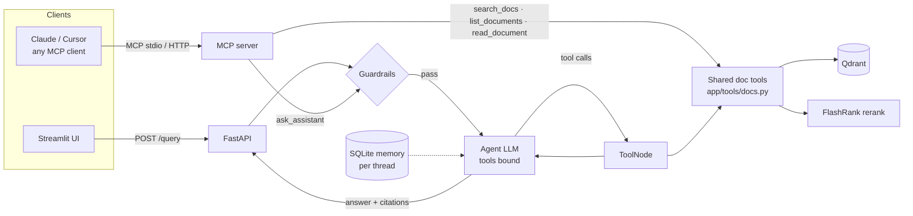

# Enterprise Agentic RAG

A tool-using agent that answers questions over internal technical documentation (Kubernetes
Jobs/CronJobs, autoscaling, Databricks jobs, cluster architecture), with cited answers and
conversation memory. The same documentation tools are also exposed as an **MCP server**, so
Claude Desktop, Claude Code, Cursor or any MCP client can search the knowledge base directly.



## How it works

**Models.** Groq `openai/gpt-oss-120b` for the agent and `openai/gpt-oss-20b` for fast checks
(the Llama 3.3 / 3.1 models used earlier were retired by Groq). Reasoning text is switched off,
so callers get only the answer. Both are overridable with `GROQ_MODEL` / `GROQ_FAST_MODEL`.
Requests fall back through a model chain (`GROQ_FALLBACK_MODELS`, default `gpt-oss-20b`, then
`qwen3.8-27b`), each with its own rate limits. On Groq's free tier the main model allows 200k tokens a
day, and a multi-step question can use 15-20k, so this keeps the assistant answering after the
limit is hit. If every model is limited, `/query` returns a 503 saying so instead of a generic error.
When the tool budget runs out, the final answer is requested in JSON mode, because a forced
`submit_answer` call fails with models that keep trying to search.

**Agent loop (LangGraph).** The LLM has three tools bound and runs in a loop with a `ToolNode`
until it replies without calling a tool:

| Tool | What it does |
|---|---|
| `search_docs(query, top_k, source?)` | Gemini-embedding vector search over Qdrant (15 candidates) → FlashRank cross-encoder rerank → top k passages, optionally restricted to one file |
| `list_documents()` | Every indexed file and its chunk count |
| `read_document(source, start_chunk, num_chunks)` | Consecutive chunks of one file, e.g. to read the full YAML around a search hit |

The model decides whether a message needs the docs at all (greetings and "what did I just ask?"
are answered from memory), rewrites follow-ups into standalone queries, retries with different
wording or a `source` filter, and expands around hits. Every passage has a stable citation id
like `cronjobs.docx#12`, and answers must cite them.

**Structured, verified answers.** The agent finishes by calling a `submit_answer` tool whose
arguments follow a Pydantic schema: `answer`, `citations`, `answered_from_docs`, `confidence`
(high / medium / low) and up to 3 `follow_up_questions`. Using a tool call makes the provider
return schema-shaped JSON in the same LLM call that writes the answer. A `finalize` graph node
then checks the result against what actually happened in the turn: any citation that no tool
returned is dropped (and removed from the answer text), and an answer that claims to come from
the docs with no valid citation is downgraded to low confidence. Plain-text answers (tool budget
and fallback paths) are parsed into the same shape, so the API, MCP and UI always see one format.

**Safety rails around the loop**
- Guardrails before the agent: deterministic jailbreak / topic checks, then NeMo Colang rails
  that match intents (off-topic, jailbreak, greeting, farewell, capabilities) by **embedding
  similarity** to example phrases, with no LLM call. NeMo's default asks the LLM to write the intent
  label; chat-tuned reasoning models such as gpt-oss answer the user instead, which silently
  disabled every rail. The similarity threshold (0.6) is the highest that never blocked a
  legitimate follow-up ("what did I just ask you?") in testing; below it, follow-ups start
  getting blocked. Off-topic questions the guard misses are refused by the agent itself
  (`answered_from_docs=false`).
- `MAX_TOOL_ROUNDS` (default 4) caps tool use per question, then forces an answer.
- Tool errors go back to the model as messages (`handle_tool_errors`) instead of crashing.
- If the tool-calling request itself fails (e.g. a malformed tool call), the agent falls back to
  one direct search + answer.
- Earlier turns are compacted to question + final answer, so tool output never bloats memory.

**Search is shaped like a recommender.** `search_docs` runs three stages:
1. *Candidate generation*: vector search pulls 15 candidates from the whole index. Optional
   **hybrid mode** adds BM25 keyword search and fuses both with Reciprocal Rank Fusion
   (`HYBRID_SEARCH=true`; off by default, see Evaluation).
2. *Ranking*: a FlashRank cross-encoder rescores the candidates.
3. *Re-ranking*: personalisation, then **MMR diversity** (relevance vs. similarity to passages
   already picked) with at most 2 chunks per file. Personalisation is a **learned ranker**
   (logistic regression on cross-encoder, vector, BM25 and vote features, trained on 👍/👎 with
   inverse-propensity weighting against position bias) once one is trained, and a small capped
   vote boost until then. New documents get a fading **exploration boost** so they can collect
   feedback at all (item cold start).

**Recommendations around each answer**
- *Related documents*: **content-based** (nearest chunks to the cited passages, by stored
  vector) plus **collaborative** ("read together in N conversations", item-to-item
  co-occurrence, minimum support 2). Content-based covers the cold start, before any history exists.
- *People who asked this also asked*: questions from other conversations citing the same passages.
- *Starter questions* for new users: the most-asked questions with a cited, non-downvoted
  answer, topped up with curated defaults when there is no traffic yet (user cold start).

Every passage shown is logged as an impression (position, cited or not, ranking features).
That log is the training data for the learned ranker and the source for collaborative filtering.
Votes are one per conversation per passage, so one user can't inflate a passage.

**One tool implementation, two front-ends.** `app/tools/docs.py` is the single implementation;
`app/agents/tools.py` wraps it for LangGraph and `app/mcp_server.py` wraps it for MCP.

## Use it from Claude or Cursor (MCP)

| Client | Setup |
|---|---|
| **Claude Code** | Already configured by [`.mcp.json`](.mcp.json) — open the repo and approve the `enterprise-docs` server. Or: `claude mcp add enterprise-docs -- "$PWD/.venv/bin/python" -m app.mcp_server` |
| **Cursor** | Already configured by [`.cursor/mcp.json`](.cursor/mcp.json) — enable it under Settings → MCP. |
| **Claude Desktop** | Add to `claude_desktop_config.json` (absolute paths; Desktop doesn't start in the repo): |

```json
{
  "mcpServers": {
    "enterprise-docs": {
      "command": "/ABSOLUTE/PATH/TO/Marathon/.venv/bin/python",
      "args": ["-m", "app.mcp_server"],
      "cwd": "/ABSOLUTE/PATH/TO/Marathon"
    }
  }
}
```

Remote / HTTP clients: `python -m app.mcp_server --transport streamable-http --port 8765`
→ `http://127.0.0.1:8765/mcp`.

MCP tools: `search_docs`, `list_documents`, `read_document` (read-only, need only Qdrant + embeddings —
the client's own model does the reasoning) and `ask_assistant` (runs this project's full agent;
needs an LLM key). All return structured output with an output schema.

## Evaluation

`evals/golden_set.json` has 24 questions (12 worded like the docs, 12 paraphrased) with the file
each answer lives in. Retrieval is scored on an index that also contains **57 unrelated technical
documents as distractors** (63 files, 5,085 chunks, 4,959 of them distractors), using local
`all-mpnet-base-v2` embeddings, at every stage of the pipeline:

| Stage (24 questions) | hit@1 | hit@5 | MRR | files in top 5 | distractors in top 5 |
|---|---|---|---|---|---|
| BM25 only | 0.667 | 0.917 | 0.755 | 2.58 | 0.27 |
| Vector only | 0.750 | 1.000 | 0.836 | 2.08 | 0.09 |
| Hybrid (vector + BM25, RRF) only | 0.792 | 0.958 | 0.852 | 1.96 | 0.14 |
| Vector → rerank | 0.833 | 0.958 | 0.878 | 2.04 | 0.10 |
| **Vector → rerank → MMR (default)** | **0.833** | **1.000** | **0.892** | **3.29** | 0.14 |
| Hybrid → rerank → MMR | 0.792 | 0.958 | 0.861 | 3.42 | 0.26 |

- **Reranking** lifts hit@1 from 0.75 to 0.83 (paraphrased questions: 0.58 to 0.75).
- **MMR** raises diversity from about 2 to 3.3 files per result list without losing accuracy;
  the trade-off is more distractor files in the freed slots (0.10 to 0.14).
- **Hybrid search helps on its own but not in the full pipeline.** Vector search already has the
  right file among its 15 candidates for every question (candidate recall@15 = 1.0), so BM25
  can't add recall; it adds keyword-overlap chunks from long distractor documents that the small
  cross-encoder then ranks too high. Hence `HYBRID_SEARCH` is off by default. It should matter
  more for exact identifiers (error codes, config keys) or with a stronger reranker.

**Learned ranker, with simulated feedback** (`python -m evals.simulate_ltr`). No real users yet, so
users are simulated on the real index: they see the top 5, examine position k with probability
1/k, and 👍 relevant passages 90% of the time (10% for irrelevant ones). Rankers are trained on
200 sessions per question and scored on held-out questions (3-fold cross-validation):

| Ranker | explicit 👍/👎: hit@1 / MRR | implicit clicks: hit@1 / MRR |
|---|---|---|
| Cross-encoder only (no learning) | 0.792 / 0.865 | 0.792 / 0.865 |
| Learned, naive | 0.750 / 0.845 | 0.667 / 0.788 |
| Learned, with position-bias correction (IPW) | 0.792 / **0.882** | 0.750 / 0.861 |

Ignoring position bias makes the learned ranker *worse* than not learning at all, most clearly
with click-style data, where the naive model learned to over-trust BM25 (weight 0.32 vs 0.07 with
IPW). With IPW it matches or slightly beats the cross-encoder. Caveats: the simulated users follow
exactly the click model IPW assumes, and 24 questions means one question moves hit@1 by 0.04.

A 24-question set is a regression check, not a benchmark.

```bash
python -m evals.run_eval                       # retrieval metrics, every stage
python -m evals.simulate_ltr                   # learned ranker vs position bias (simulated users)
python -m evals.run_eval --answers             # + agent: mention rate, citation rate, avg tool calls
```

## Quick start

```bash
python -m venv .venv && source .venv/bin/activate
pip install -r requirements.txt
cp .env.example .env               # Groq + Gemini keys; Qdrant URL/key, or QDRANT_PATH for local mode

python -m app.ingestion.processor DATA/true_data true      # add --wipe to rebuild
uvicorn app.main:app --reload                             # REST API on :8000
streamlit run ui/app.py                                   # chat UI on :8501
python -m app.mcp_server                                  # MCP server (stdio)
```

### With Docker (whole stack, one command)

```bash
cp .env.example .env                  # fill in GROQ_API_KEY and GEMINI_API_KEY
docker compose up -d --build          # Qdrant + API (:8000) + UI (:8501)
docker compose run --rm ingest        # first run only: index DATA/true_data into the Qdrant container
docker compose logs -f api            # watch the agent's logs
docker compose down                   # stop (add -v to also delete the index and memory volumes)
```

One image (`Dockerfile`) serves the API, UI and ingestion — Compose picks the command. It uses
`python:3.11-slim`, CPU-only PyTorch, a non-root user, a `/health` healthcheck and a pre-downloaded
reranker model; dependencies are installed before the code is copied so rebuilds after code changes
are fast. Secrets come from `.env` at runtime (`.dockerignore` keeps them out of the image), and
Qdrant data and conversation memory live in named volumes.

No Qdrant server? Set `QDRANT_PATH=./qdrant_local` to use embedded on-disk Qdrant.
(Embedded mode allows one process at a time — don't run ingestion and a server simultaneously.)

REST API:

```bash
curl -X POST localhost:8000/query -H 'content-type: application/json' \
     -d '{"q": "How do I stop overlapping CronJob runs?"}'
# -> {answer, thread_id, thought_process: ["Tool: search_docs(query=...)", ...],
#     sources: [{id, source, chunk_index, content, score}],
#     structured: {citations, confidence, answered_from_docs, follow_up_questions, invalid_citations},
#     related_documents, related_questions, status}
```

Pass the returned `thread_id` back to continue a conversation. `GET /graph` renders the agent
graph; `GET /health` is a liveness probe.

## Tests

```bash
pytest -q tests     # 81 tests, fully offline (scripted fake LLM, in-memory corpus)
```

Covers the tool-calling loop (search → cite, memory turns without tools, multi-tool plans with
source filter + read, tool budget, degraded fallback, history compaction), the MCP server through
a real MCP client session (tool listing, schemas, annotations, errors), guardrails, chunking,
idempotent IDs, BM25 / RRF, MMR diversity, feedback, collaborative and content-based
recommendations, cold start, the learned ranker and IPW, and the REST API contract.

## Project layout

```
app/
  main.py                 FastAPI app
  mcp_server.py           MCP server (stdio / streamable HTTP)
  agents/                 graph (agent ⇄ tools), agent node, LangChain tool wrappers, service
  tools/docs.py           shared doc tools used by both the agent and MCP
  core/intent.py          keyword / jailbreak matching for the guardrail gate
  guardrails/             NeMo Colang rails
  gateway/client.py       Portkey / Groq LLM access with key fallback
  ingestion/              loaders, chunker, ingestion CLI
  services/retrieval/     embeddings, Qdrant access, FlashRank rerank
ui/app.py                 Streamlit chat UI
evals/                    golden set + eval runner
tests/                    pytest suite
Dockerfile                one image for API / UI / ingestion
docker-compose.yml        Qdrant + API + UI (+ ingest job)
```

## Known limitations

- Answers are not streamed token-by-token.
- SQLite memory is single-node; use a Postgres checkpointer for multi-replica deployments.
- No auth on the REST API or the HTTP MCP transport; `thread_id` isn't tied to a user identity.
