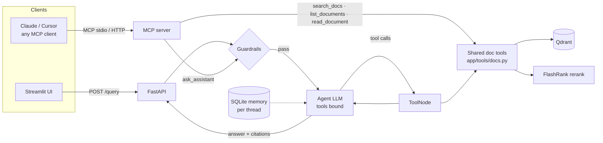

# Enterprise Agentic RAG

A tool-using agent that answers questions over internal technical documentation (Kubernetes
Jobs/CronJobs, autoscaling, Databricks jobs, cluster architecture), with cited answers and
conversation memory. The same documentation tools are also exposed as an **MCP server**, so
Claude Desktop, Claude Code, Cursor or any MCP client can search the knowledge base directly.



## How it works

**Agent loop (LangGraph).** The LLM has three tools bound and runs in a loop with a `ToolNode`
until it replies without calling a tool:

| Tool | What it does |
|---|---|
| `search_docs(query, top_k, source?)` | Gemini-embedding vector search over Qdrant (15 candidates) → FlashRank cross-encoder rerank → top k passages, optionally restricted to one file |
| `list_documents()` | Every indexed file and its chunk count |
| `read_document(source, start_chunk, num_chunks)` | Consecutive chunks of one file, e.g. to read the full YAML around a search hit |

The model decides whether a message needs the docs at all (greetings and "what did I just ask?"
are answered from memory), rewrites follow-ups into standalone queries, retries with different
wording or a `source` filter, and expands around hits. Every passage has a stable citation id
like `cronjobs.docx#12`, and answers must cite them.

**Safety rails around the loop**
- Guardrails before the agent: deterministic jailbreak / topic checks, then NeMo Colang rails.
- `MAX_TOOL_ROUNDS` (default 4) caps tool use per question, then forces an answer.
- Tool errors go back to the model as messages (`handle_tool_errors`) instead of crashing.
- If the tool-calling request itself fails (e.g. a malformed tool call), the agent falls back to
  one direct search + answer.
- Earlier turns are compacted to question + final answer, so tool output never bloats memory.

**One tool implementation, two front-ends.** `app/tools/docs.py` is the single implementation;
`app/agents/tools.py` wraps it for LangGraph and `app/mcp_server.py` wraps it for MCP.

## Use it from Claude or Cursor (MCP)

| Client | Setup |
|---|---|
| **Claude Code** | Already configured by [`.mcp.json`](.mcp.json) — open the repo and approve the `enterprise-docs` server. Or: `claude mcp add enterprise-docs -- "$PWD/.venv/bin/python" -m app.mcp_server` |
| **Cursor** | Already configured by [`.cursor/mcp.json`](.cursor/mcp.json) — enable it under Settings → MCP. |
| **Claude Desktop** | Add to `claude_desktop_config.json` (absolute paths; Desktop doesn't start in the repo): |

```json
{
  "mcpServers": {
    "enterprise-docs": {
      "command": "/ABSOLUTE/PATH/TO/Marathon/.venv/bin/python",
      "args": ["-m", "app.mcp_server"],
      "cwd": "/ABSOLUTE/PATH/TO/Marathon"
    }
  }
}
```

Remote / HTTP clients: `python -m app.mcp_server --transport streamable-http --port 8765`
→ `http://127.0.0.1:8765/mcp`.

MCP tools: `search_docs`, `list_documents`, `read_document` (read-only, need only Qdrant + embeddings —
the client's own model does the reasoning) and `ask_assistant` (runs this project's full agent;
needs an LLM key). All return structured output with an output schema.

## Evaluation

`evals/golden_set.json` has 12 questions with the source file each answer lives in.

| Metric (true_data corpus, Gemini embeddings + FlashRank) | Result |
|---|---|
| hit@5 (expected source in top 5 passages) | **12/12 (1.00)** |
| MRR | **1.00** |

A small, single-corpus set — treat it as a regression check, not a benchmark. Next step: index
`noisy_data` (~60 distractor documents) and report `noise@5`.

```bash
python -m evals.run_eval                       # retrieval metrics
python -m evals.run_eval --answers             # + agent: mention rate, citation rate, avg tool calls
```

## Quick start

```bash
python -m venv .venv && source .venv/bin/activate
pip install -r requirements.txt
cp .env.example .env               # Groq + Gemini keys; Qdrant URL/key, or QDRANT_PATH for local mode

python -m app.ingestion.processor DATA/true_data true      # add --wipe to rebuild
uvicorn app.main:app --reload                             # REST API on :8000
streamlit run ui/app.py                                   # chat UI on :8501
python -m app.mcp_server                                  # MCP server (stdio)
```

### With Docker (whole stack, one command)

```bash
cp .env.example .env                  # fill in GROQ_API_KEY and GEMINI_API_KEY
docker compose up -d --build          # Qdrant + API (:8000) + UI (:8501)
docker compose run --rm ingest        # first run only: index DATA/true_data into the Qdrant container
docker compose logs -f api            # watch the agent's logs
docker compose down                   # stop (add -v to also delete the index and memory volumes)
```

One image (`Dockerfile`) serves the API, UI and ingestion — Compose picks the command. It uses
`python:3.11-slim`, CPU-only PyTorch, a non-root user, a `/health` healthcheck and a pre-downloaded
reranker model; dependencies are installed before the code is copied so rebuilds after code changes
are fast. Secrets come from `.env` at runtime (`.dockerignore` keeps them out of the image), and
Qdrant data and conversation memory live in named volumes.

No Qdrant server? Set `QDRANT_PATH=./qdrant_local` to use embedded on-disk Qdrant.
(Embedded mode allows one process at a time — don't run ingestion and a server simultaneously.)

REST API:

```bash
curl -X POST localhost:8000/query -H 'content-type: application/json' \
     -d '{"q": "How do I stop overlapping CronJob runs?"}'
# -> {answer, thread_id, thought_process: ["Tool: search_docs(query=...)", ...],
#     sources: [{id, source, chunk_index, content, score}], status}
```

Pass the returned `thread_id` back to continue a conversation. `GET /graph` renders the agent
graph; `GET /health` is a liveness probe.

## Tests

```bash
pytest -q tests     # 38 tests, fully offline (scripted fake LLM, in-memory corpus)
```

Covers the tool-calling loop (search → cite, memory turns without tools, multi-tool plans with
source filter + read, tool budget, degraded fallback, history compaction), the MCP server through
a real MCP client session (tool listing, schemas, annotations, errors), guardrails, chunking,
idempotent IDs and the REST API contract.

## Project layout

```
app/
  main.py                 FastAPI app
  mcp_server.py           MCP server (stdio / streamable HTTP)
  agents/                 graph (agent ⇄ tools), agent node, LangChain tool wrappers, service
  tools/docs.py           shared doc tools used by both the agent and MCP
  core/intent.py          keyword / jailbreak matching for the guardrail gate
  guardrails/             NeMo Colang rails
  gateway/client.py       Portkey / Groq LLM access with key fallback
  ingestion/              loaders, chunker, ingestion CLI
  services/retrieval/     embeddings, Qdrant access, FlashRank rerank
ui/app.py                 Streamlit chat UI
evals/                    golden set + eval runner
tests/                    pytest suite
Dockerfile                one image for API / UI / ingestion
docker-compose.yml        Qdrant + API + UI (+ ingest job)
```

## Known limitations

- Answers are not streamed token-by-token.
- SQLite memory is single-node; use a Postgres checkpointer for multi-replica deployments.
- No auth on the REST API or the HTTP MCP transport; `thread_id` isn't tied to a user identity.
